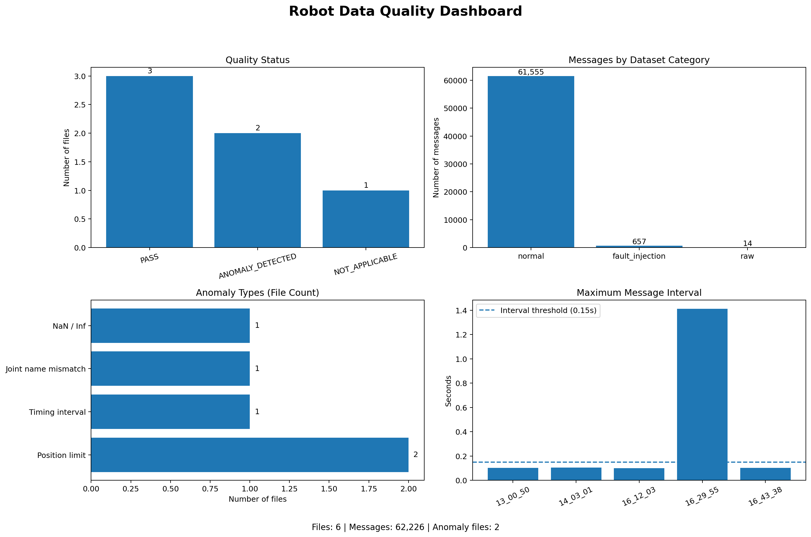

# Robot Data Quality Pipeline

**基于 ROS 2、MCAP 和 Python 的机器人关节状态数据质量分析与异常检测项目**

## 1. 项目简介

本项目构建了一套面向机器人关节状态数据的质量检测流程，使用 ROS 2 生成和录制六自由度机械臂模拟数据，通过 MCAP 保存数据，并使用 Python 完成数据解码、统计分析、异常检测和质量报告生成。

项目覆盖正常数据与人工故障注入数据，验证了检测流程对数值异常、关节名称异常和时间间隔异常的识别能力。

## 2. 核心功能

- ROS 2 `/joint_states` 数据发布、录制和回放
- MCAP 文件读取与 ROS 2 消息解码
- 六关节位置、速度和力矩数据统计
- 消息频率与时间间隔分析
- NaN / Inf 检测
- 关节名称和字段长度完整性检查
- 关节位置阈值检测
- 时间间隔异常检测
- 批量数据集清单生成
- 数据质量汇总与可视化

## 3. 技术栈

| 技术                     | 用途              |
| ---------------------- | --------------- |
| Python                 | 数据处理、统计与异常检测    |
| ROS 2 Jazzy            | 机器人消息发布与录制      |
| MCAP                   | 机器人数据存储格式       |
| sensor_msgs/JointState | 关节状态消息          |
| rclpy                  | ROS 2 Python 接口 |
| matplotlib             | 数据可视化           |
| CSV / JSON             | 数据质量报告          |

## 4. 数据集

当前数据集包含 6 个 MCAP 文件：

| 数据类别            |   文件数 |        消息数 |
| --------------- | ----: | ---------: |
| Normal          |     3 |     61,555 |
| Fault Injection |     2 |        657 |
| Raw             |     1 |         14 |
| **Total**       | **6** | **62,226** |

正常数据包含六个关节：

`joint_1, joint_2, joint_3, joint_4, joint_5, joint_6`

模拟数据发布频率约为 10 Hz。

## 5. 异常检测规则

| 检测项目             | 检测内容                                    |
| ---------------- | --------------------------------------- |
| Joint Name       | 检查关节名称是否符合预期                            |
| Field Length     | 检查 name、position、velocity、effort 长度是否一致 |
| Numeric Validity | 检查 NaN 和 Inf                            |
| Position Limit   | 检查位置是否超过实验阈值 ±0.55                      |
| Timing Interval  | 检查消息间隔是否超过 0.15 秒或非正数                   |
| Duplicate Names  | 检查重复关节名称                                |

上述阈值是本项目模拟数据的实验检测参数，不代表通用机器人安全限制。

## 6. 故障注入与验证

项目通过人为修改模拟数据，构造以下异常：

| 故障类型   | 注入方式                     | 检测结果 |
| ------ | ------------------------ | ---- |
| 位置越界   | 将关节位置设置为 0.8             | 检测成功 |
| 关节名称错误 | 将 joint_6 改为 joint_extra | 检测成功 |
| NaN    | 将关节位置设置为 NaN             | 检测成功 |
| 时间间隔异常 | 构造较大的消息时间间隔              | 检测成功 |

## 7. 实验结果

| 数据类别            | 文件数 | 检测状态             |
| --------------- | --: | ---------------- |
| Normal          |   3 | PASS             |
| Fault Injection |   2 | ANOMALY_DETECTED |
| Raw             |   1 | NOT_APPLICABLE   |

所有三份正常数据均通过当前检测规则，两份故障注入数据均成功识别出预设异常。

## 8. 数据质量可视化



仪表盘展示：

- 数据质量状态分布
- 不同数据类别的消息数量
- 异常类型分布
- 各 MCAP 文件的最大消息间隔

## 9. 项目目录

```text
robot_data_quality/
├── data/
│   ├── normal/
│   ├── fault_injection/
│   ├── raw/
│   └── ...
├── reports/
│   ├── anomaly_report.csv
│   ├── anomaly_summary.csv
│   ├── dataset_manifest.csv
│   ├── dataset_manifest.json
│   ├── quality_report.json
│   ├── quality_summary.json
│   ├── joint_quality_report.json
│   ├── joint_statistics.csv
│   ├── topic_statistics.csv
│   ├── joint_timeseries.png
│   └── quality_dashboard.png
└── src/
    ├── analyze_mcap.py
    ├── inspect_mcap.py
    ├── decode_mcap.py
    ├── decode_joint_states.py
    ├── generate_joint_report.py
    ├── detect_anomalies.py
    ├── build_dataset_manifest.py
    ├── generate_quality_summary.py
    ├── plot_quality_dashboard.py
    ├── joint_state_publisher.py
    ├── joint_state_fault_simulator.py
    └── plot_joint_states.py
```

## 10. 运行方式

激活环境：

```bash
source ~/mcap_ros_env/bin/activate
source /opt/ros/jazzy/setup.bash
```

生成数据集清单：

```bash
python src/build_dataset_manifest.py
```

生成质量汇总：

```bash
python src/generate_quality_summary.py
```

生成可视化仪表盘：

```bash
python src/plot_quality_dashboard.py
```

## 11. 后续计划

- 完善时间戳重复和倒退检测
- 增加多文件批量异常检测
- 增加更完整的字段完整性检查
- 探索机器人数据集标准化与 LeRobot 数据格式转换
- 进一步研究模仿学习数据预处理流程

## 12. 项目说明

本项目当前使用模拟六自由度机械臂数据进行工程流程验证，尚未使用真实机器人硬件采集数据，也不代表生产环境中的完整安全验证系统。

